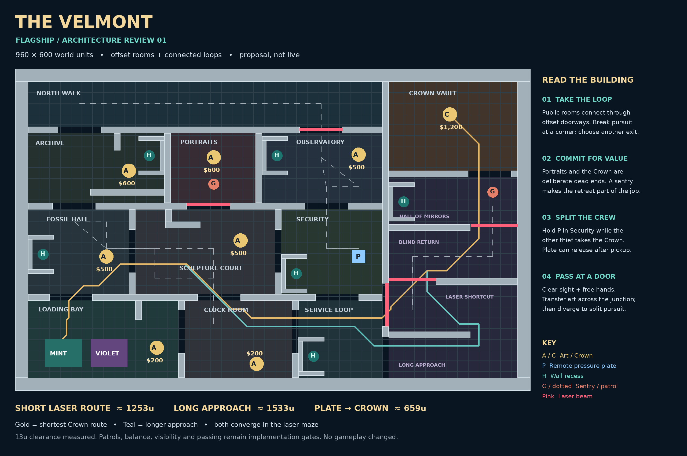

# The Velmont — blueprint review 01

**Design only, awaiting Temi's blueprint approval.** No live engine, arena, renderer, tuning, networking or timer code is changed. This branch is not a release candidate.



## What this design changes

One asymmetric building with twelve labelled spaces: eleven rooms/passages and the North Walk. Partition junctions are offset between floors of the drawing; they are not mirrored or rotated. Archive shelving and attached wall returns break long sightlines. Galleries connect through a northern loop and a southern loop. Portrait Gallery and Crown Vault are deliberate dead ends. Six wall-attached recesses supply hiding positions.

The loading bay has adjacent Mint/Violet docks. The drawn Mint route avoids the Violet dock's existing forbidden zone. This is **not** proof of rival fairness; reversed-seat matches and nearby-loot access still need comparison. The future arena adapter must replace the engine's hard-coded dock positions consistently in gameplay, guard exclusions and presentation. This design initially depicts two crews; six-player capacity and any three-crew configuration are not approved by this blueprint.

### Playable decisions to evaluate after approval

1. **Small collection run:** Loading Bay → Fossil Hall → Sculpture Court, returning by Clock Room instead of retracing the guarded gallery. Moderate rewards, multiple exits.
2. **Deep gallery run:** Archive/Portrait/Observatory offer different commitments: shelving, posted dead end, or a laser at the North Walk shortcut. Not one identical high-value corner per crew.
3. **Crown run:** split at Security; one thief holds the plate, the other enters Hall of Mirrors. The short entrance adds a laser. The longer entrance avoids that beam but joins the same two internal maze beams. It is a safer approach, not a laser-free Crown route.
4. **Handoff escape:** carrier at (590,335), empty-handed human at (410,335), 180u apart with clear sight through the Security doorway. Human carries west; bot can retreat south through Security toward Service Loop. Trigger and receiver-safety logic are not implemented.

The plate remains pressure-held until Crown pickup, matching the current engine. It may release immediately afterward; no latch timer is required. Loot remains eight pieces totalling **$4,300 including the $1,200 Crown**, as in the current 2/4-player engine. The six-player ten-piece distribution needs separate authoring while preserving that total.

## Measured, not assumed

`measurements.json` contains approximate shortest paths on a 4u eight-neighbour grid, using the engine's square-inflated 13u clearance and no corner cutting. Crown approach paths include the opposing dock exclusion. It is a static geometry measurement, not a match simulation or exact continuous shortest-path proof.

`engine-check.json` records checks using the actual existing `clear`, `sight`, `steer`, and `move` functions:

- 19 art/plate/dock/hide/sentry targets clear at radius 13.
- All 19 targets reached using the current engine navigation.
- Both crews reach all 15 art/plate/hide targets with the opposing dock blocked: 30 journeys.
- 27 authored patrol segments clear at radius 13, sampled every ≤1u; patrol brains, pursuit and dock avoidance still need match tests.
- Plate has no direct sight to Crown.
- The proposed handoff has clear sight at 180u.

An early draft had recess mouths too small for the engine's 20u navigation grid; their openings were widened before this review. A patrol segment near the Security recess was also corrected.

## Open design risks — not passed gates

- The unobstructed Crown out-and-back trip is only about 23 seconds at current speeds. The requested 90% no-banking-before-0:45-remaining gate is **unproven**. Longer geometry alone does not establish it. Sentry pressure, lasers and the plate must be simulated before asserting that rushing is no longer dominant.
- Two dock positions in one bay do not guarantee equal opportunity. The closest $200 piece favours Violet; public-gallery access favours Mint. Full collection outcomes, swapped crew positions and congestion need testing, not an assumption of fairness.
- Narrower routes may amplify jams at six players. This is a 960×600 architectural proposal, not a capacity certification.
- North Walk is an 84u-wide straight connector; it is intentionally legible, not another mini-maze. The layout does not claim every corridor satisfies the quoted 64–80u range or that every shortest Crown path has six forced turns.
- Archive is a compact shelf obstacle section, not a fully developed multi-aisle maze. Its reward/depth balance needs playtesting.
- Emitter sirens previously changed balance materially. Reuse requires new gates; they are only diagrammed here.
- The current engine already allows bot art passes, but only under restrictive chase, return-route and safety conditions. A requested `Pass it!` action must address those conditions rather than adding a second incompatible throw mechanic.
- Visibility memory is a separate implementation step. Static rooms may retain a dim memory; unseen guards should not look like current positions. Teammate markers remain visible.

No unit-suite, idle, escape, difficulty, CPU, rush-Crown, passing-success or multiplayer gate is claimed for this unimplemented museum. After blueprint approval, implement on this branch and run each gate before requesting merge approval. Preserve the Friday October 30, 6 PM America/Chicago hard stop.

## Reproduce

```sh
python docs/flagship-velmont/blueprint.py
node --experimental-strip-types docs/flagship-velmont/check-blueprint.ts
```

Python needs Pillow. All outputs are review artifacts under this directory; nothing is imported by the application.
