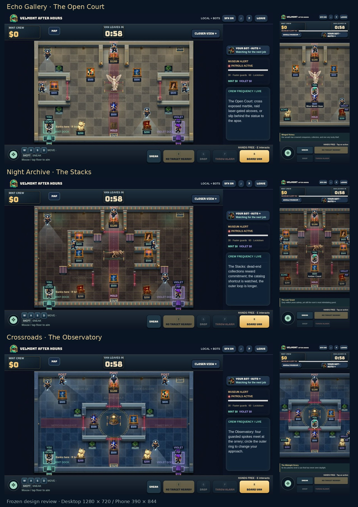

# Museums v2 — review branch

**Not cleared to merge or deploy. Failed gates are retained below.**

Three mirrored architectures: Echo's open court and gated side alcoves; the Archive's shelf aisles, blind collection ends, catalog crossing and laser-gated folio vault; the Observatory's circular floor hub, four guarded spokes and outer loop. Population plans preserve the same fair wing structure while changing partition lengths. Existing skins, painted centrepieces and lore remain. Rooms, patrol circuits, staff entries, hiding recesses and solid exhibit footprints follow the new architecture.

Only arena data, render/review presentation, and verification code changed. No engine, networking, score values, timers or difficulty tuning changed. The existing budget is **$4,300 including the $1,200 jackpot**, not $5,500. Six-player games retain their existing $500/$400 redistribution instead of introducing $600 pieces.

## Gates

- Unit tests: **222 passed**; TypeScript: **PASS**.
- Reachability/sentries: **9/9 plans**, **54/54 mode/difficulty/population setups**. Radius 13, both docks, all art/plate/niches, collision-safe guard routes.
- Paired-art and centre-objective fairness: **0.000000% maximum difference**. Pocket-art random offsets: **0.199%** across all 25 offset combinations.

### Thirty matches per museum

A detected stop means a bot remained within 10 units of its anchor for at least 6 seconds. Escaped, tied, hidden, and active short interaction channels are excluded. One detection per bot per match. Ten games per capacity (2/4/6), with Rookie/Normal/Pro represented and a naive human collector. The literal zero-idle gate includes deliberate waits; those are **not silently discarded**. Counts describe detections, not proof that every wait is a defect.

| Museum | Matches | Detected ≥6s stops | Dock waits with only jackpot left | Plate holds | Rescue waits | Unexplained | Literal gate |
|---|---:|---:|---:|---:|---:|---:|---|
| Echo Gallery | 30 | 13 | 10 | 2 | 1 | 0 | FAIL |
| Night Archive | 30 | 13 | 6 | 3 | 4 | 0 | FAIL |
| Crossroads | 30 | 21 | 14 | 7 | 0 | 0 | FAIL |

Rookie autonomous crews already stop pursuing a locked jackpot when ordinary art is gone. Changing that behavior is outside this layout-only change. Raw cases are in idle-0/1/2.json.

### Echo left behind at the van

Same idle-human/Auto-Echo policy as v73, seeds 1001–1040, 40 per difficulty.

| Difficulty | Escaped | Tied at finish | Left behind | Gate ≤2/40 |
|---|---:|---:|---:|---|
| rookie | 40 | 0 | 0 | PASS |
| normal | 40 | 0 | 0 | PASS |
| pro | 38 | 2 | 0 | PASS |

### Difficulty versus v73

Naive collector + Auto Echo, unchanged policy, seeds 1001–1040. Strict wins; ties are not wins. Required difference: ±10 percentage points per cell.

| Mode | Difficulty | Games | v73 | Candidate | Change (pp) | Gate |
|---|---|---:|---:|---:|---:|---|
| coop | rookie | 40 | 92.5% | 82.5% | -10.0 | PASS |
| coop | normal | 40 | 52.5% | 57.5% | +5.0 | PASS |
| coop | pro | 40 | 20.0% | 22.5% | +2.5 | PASS |
| duos | rookie | 40 | 90.0% | 97.5% | +7.5 | PASS |
| duos | normal | 40 | 50.0% | 62.5% | +12.5 | FAIL |
| duos | pro | 40 | 25.0% | 50.0% | +25.0 | FAIL |

### Nearest $2,600 collection distance

Metric: minimum **sum of individual dock-to-art shortest paths** for a subset worth at least $2,600; not a multi-pickup traveling-salesperson route. Visibility graph uses radius-13 expanded rectangular obstacles. Lasers remain traversable hazards; temporary guards are excluded from architectural fairness. Each crew's actual carried-art journey still includes return trips, alarms and guards.

| Museum | Capacity | Mint distance (u) | Violet distance (u) | Difference |
|---|---:|---:|---:|---:|
| Echo Gallery | 2 | 1729.9 | 1729.9 | 0.000000% |
| Night Archive | 2 | 2095.5 | 2095.5 | 0.000000% |
| Crossroads | 2 | 1711.5 | 1711.5 | 0.000000% |
| Echo Gallery | 4 | 1754.6 | 1754.6 | 0.000000% |
| Night Archive | 4 | 2114.5 | 2114.5 | 0.000000% |
| Crossroads | 4 | 1719.4 | 1719.4 | 0.000000% |
| Echo Gallery | 6 | 1678.6 | 1678.6 | 0.000000% |
| Night Archive | 6 | 1947.4 | 1947.4 | 0.000000% |
| Crossroads | 6 | 1680.2 | 1680.2 | 0.000000% |

### Host tick cost

Three paired runs per museum, four thieves, same deterministic two-human collector policy and seed in each pair. Table shows median whole-match p95 of E.advance(40ms), alternating baseline/candidate order. Input-policy calculation is outside the timer. This is local Node simulation timing, not browser frame rate or internet latency.

| Museum | v73 p95 (ms) | Candidate p95 (ms) | Change | No-regression gate |
|---|---:|---:|---:|---|
| Echo Gallery | 2.741 | 2.273 | -17.1% | PASS |
| Night Archive | 1.323 | 4.194 | +217.1% | FAIL |
| Crossroads | 3.910 | 7.632 | +95.2% | FAIL |

## Screenshots

Frozen development fixtures, not live-match evidence. Desktop 1280×720 full map; phone 390×844 closer view near each centrepiece. Actors are positioned clear of centrepieces for architecture review.

| Museum | Desktop | Phone |
|---|---|---|
| Echo Gallery | [Full map](screenshots/museums-v2-echo-desktop.jpg) | [Closer view](screenshots/museums-v2-echo-phone.jpg) |
| Night Archive | [Full map](screenshots/museums-v2-archive-desktop.jpg) | [Closer view](screenshots/museums-v2-archive-phone.jpg) |
| Crossroads | [Full map](screenshots/museums-v2-crossroads-desktop.jpg) | [Closer view](screenshots/museums-v2-crossroads-phone.jpg) |

## Reproduce

Baseline: git worktree add --detach ../velmont-v73 7db285ee540546db14001349aedb5737fca2b8af. Run pnpm test, node scripts/run-museums-v2-gates.mjs, node --experimental-strip-types scripts/benchmark-museums-v2.ts, then node scripts/report-museums-v2.mjs. The benchmark waits for an explicitly pending idle-audit-state.json so concurrent audits do not contaminate timing. Keep the benchmark isolated from other heavy jobs.

Legacy tests that required asymmetric maps were updated to mirror fairness. Dead-end aisle access is checked without demanding a second exit; other existing two-route tests still pass. The old interaction fixture now clears modern niches/sensors so it actually tests the original fixed geometry. New 5% fairness and nearest-$2,600 assertions were added. No behavioral acceptance threshold was weakened.

Source fingerprint (engine + arenas): 7142b6d90dc23002bbad0ca3752ce50ba6030d5635554605b8b35d135a5d6357.
