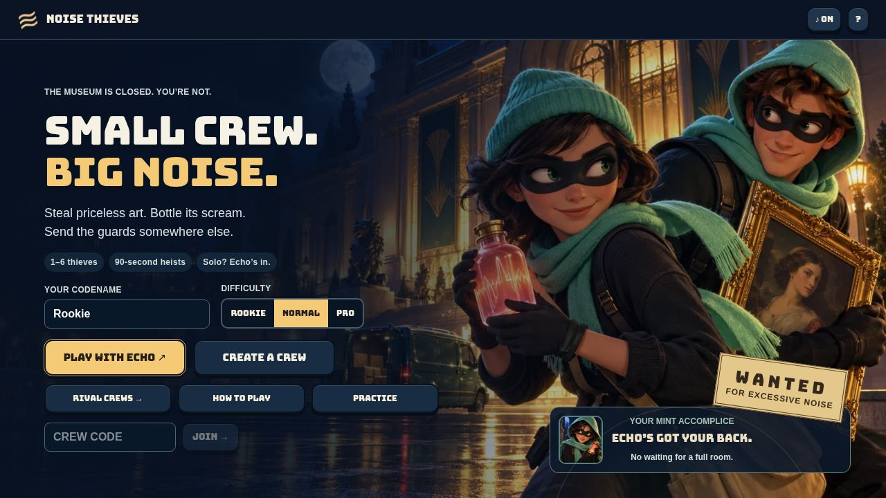
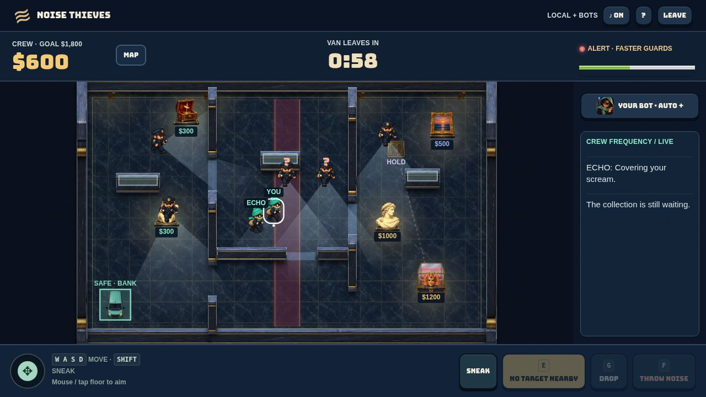
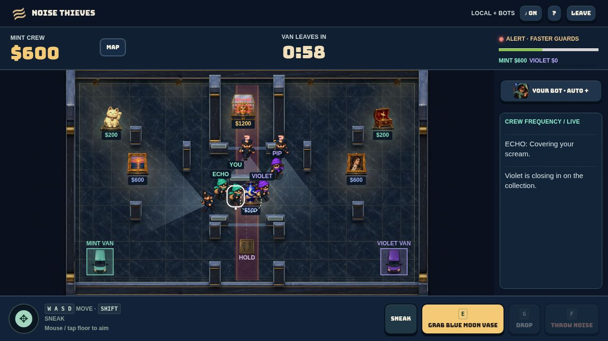
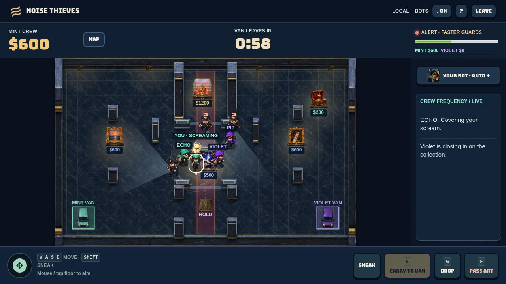
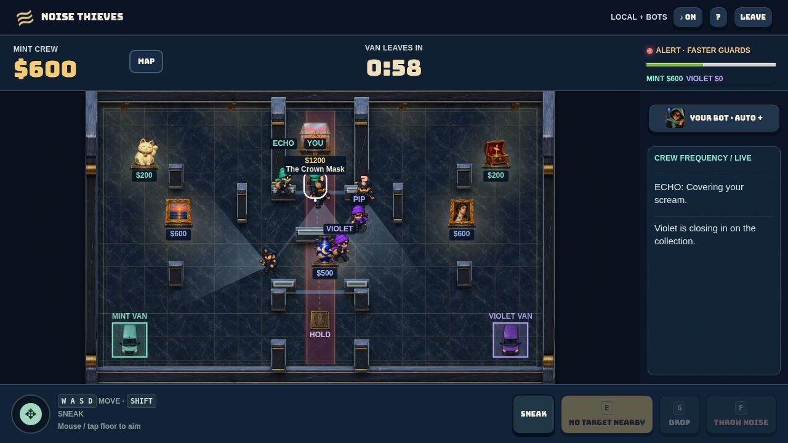
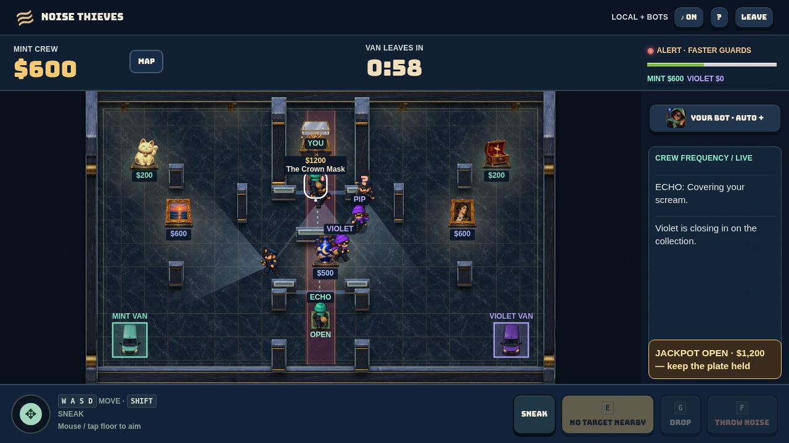
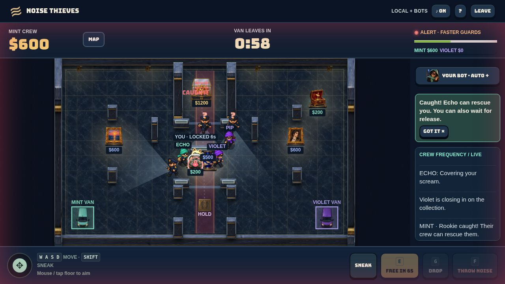
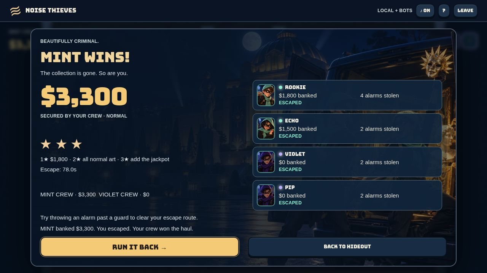

# Noise Thieves v25 — painted sprite pass

Visual-only update. No engine, bot, map geometry, loot placement, network loop, or difficulty-policy changes. Claude's supplied suggestions informed the brief; Claude did not author or modify this build.

## Shipped
- Original OpenAI-generated exhibit, mint/violet thief, guard, van, wall, floor, plate, case and border-decoration assets. 33 atlas frames; transparent WebP atlas plus tiled floor. All text remains live.
- Browser preloading with primitive fallback if assets fail. Directional/flip and carry poses; carried art above the thief. Mint Echo and mint human, violet rivals.
- Compact art, warm pools, small prices, nearby-only names, combined stacked actor labels, local-player outline. Painted wall faces follow existing collision rectangles exactly. Decoration does not create obstacles.
- Locked/open glass-case sprites, red lasers, live plate line and open banner; contextual E/F/G/R controls preserved.
- Compact Echo + radio sidebar; phone instruction wrapping and six-second tips; portrait hero crop; recap names with crew pips instead of repeated crew names.

## Scope decision
Loot redistribution (two pieces per room / 120-unit spacing / changing plate placement) is intentionally not implemented: it changes the approved map and balance. The existing placement and danger gates are preserved.

## Assets
New v25 asset directory: 608,560 bytes. Complete public/art directory: 1,541,220 bytes (about 1.54 MB). Both include JSON metadata; image bytes alone are slightly smaller. Sources: four original OpenAI image-generation outputs on 2026-10-22, packed using scripts/pack-sprites-v25.py. Sprite frames in public/art/v25/frames.json. No third-party game art copied.

## Validation
- 104/104 tests passed, including three sprite asset/fallback/direction checks.
- TypeScript check passed.
- Difficulty gate passed, using the existing hash-matched 240-match matrix (unchanged engine and policy), not newly claimed playtest data: co-op Rookie 97.5%, Normal 67.5%, Pro 22.5%; rivals 65%, 62.5%, 50%.
- Engine/client-loop/difficulty-gate diff against v24 is empty.
- Browser visual QA at 1280×720 and 390×844. Home fits desktop without scroll. Captured all requested states below. Capture, jackpot and recap screenshots are deliberately frozen development fixtures, not claimed live match outcomes. Production disables fixture routes.

## Limits
No new full multiplayer playthrough, physical-phone testing, low-end-device FPS benchmark or production-network latency measurement in this visual pass. No claim that artwork exactly reproduces the concept image. The fixed top-down arena and gameplay geometry remain authoritative.

## Screenshots

### Home

[Phone screenshot](home-phone.jpg)

### Co-op

[Phone screenshot](coop-phone.jpg)

### Rivals centre

[Phone screenshot](centre-phone.jpg)

### Carried art

[Phone screenshot](carried-phone.jpg)

### Locked jackpot

[Phone screenshot](jackpot-locked-phone.jpg)

### Open jackpot

[Phone screenshot](jackpot-open-phone.jpg)

### Capture

[Phone screenshot](capture-phone.jpg)

### Recap

[Phone screenshot](recap-phone.jpg)
