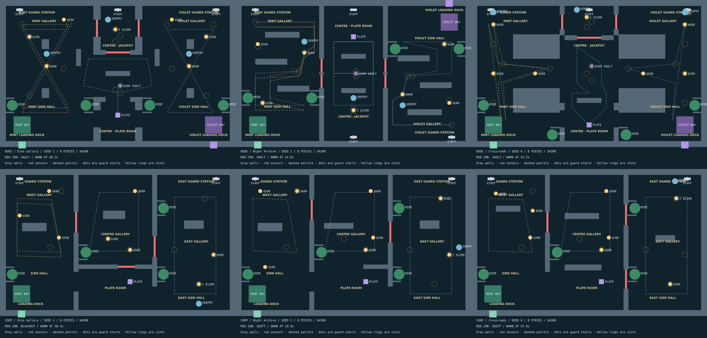

# Architecture and clarity pass (v33)

Continues the v32 Velmont: After Hours rename. The public URL stays unchanged.

## Architecture self-check

| Request | Result / limit |
| --- | --- |
| Named rooms | Fixed, authored Gallery, Side Hall, Loading Dock, Guard Station and shared jackpot/plate areas. Faint canvas names and an expandable named MAP. Gallery keeps pillars; Archive shelves and rotational symmetry; Crossroads its hub. Guard stations are open staff vestibules, not enclosed extra rooms. |
| Two routes | Navigation tests find two thief-body-clear alternatives from each crew van to every exhibit and the plate in both modes. The second avoids a 45-unit disc on the middle of the first (25 for short routes). This proves a usable detour, not fully edge-disjoint paths all the way to each plinth. Upper Gallery/Crossroads entries and Archive's paired doorways provide loops. |
| Hiding | Four fixed wall recesses per map, curtain/planter treatment. Staff clearance >=100; sentry clearance >=120; outside bays; close to a used exhibit/plate return route. No rule-driven top-edge placement. Crossroads's inner pair is at the lower plate-room entrance. |
| Lasers | Beam endpoints touch real doorway walls. Fixed entrance gates, symmetric in rivals. No Archive floating stubs. |
| Sentries | Wall-side posts retain the 30-unit exclusion-route test and avoid niches. **Not every seeded post has its own newly built physical alcove.** Post selection is still constrained by the seeded exhibit and clear-route test; this part is not a complete hand-authored post replacement. |
| Vans | Mint exits south; Archive Violet exits north, other Violet exits south. Both sprites face out, beyond the outer wall. LOADING BAY remains floor paint. |
| Centre size | Prior enlarged centre and extra exits retained. **A centre 20% larger than either side has not been established by an area comparison.** Do not treat the old width-expansion test as proof of this new ratio. |
| Ducts | Omitted, as optional, to avoid adding a new movement system. |

## Clarity and rules

- TIED UP + visible rope coils; Untie remains 1.2 seconds. Solo wriggle timer unchanged.
- Player-facing instructions use ALARM: grab, throw, alarm in hand. Old internal data keys remain compatible.
- Rivals stars: winning haul; winning with the whole crew escaped; winning with the jackpot. A losing crew earns no stars. Ties share a win, consistent with the existing rivals result.
- HIGHLIGHT is separate from a situation-based PRO TIP. Singular alarm count is corrected.
- Get to the van is a manual order. Auto Echo returns, banks carried art and boards when its human boards. Browser check confirmed the order is selectable and ends the job once both board.

## Rendered maps

Each mode/layout has four distinct seeded overview SVGs (`coop-0-0.svg` through `duos-2-3.svg`). `renders.json` lists their seeds. Each also has nine objective route drawings, e.g. [Archive jackpot routes](duos-1-routes-2.svg). Solid and dashed lines are the two alternatives, mint/violet distinguish crews. Route drawings use real collision geometry, not illustrations.

- [Rivals Gallery](duos-0-0.svg) · [Archive](duos-1-0.svg) · [Crossroads](duos-2-0.svg)
- [Co-op Gallery](coop-0-0.svg) · [Archive](coop-1-0.svg) · [Crossroads](coop-2-0.svg)

Visually checked the six-map overview: Gallery is an open pillar hall; Archive has staggered shelf aisles and opposed docks; Crossroads has four large corner masses around the shared hub. Co-op retains its three-room structure and receives the authored recesses, gates and room labels rather than becoming identical to rivals.

## Validation

Simulated win rates are for the fixed naive collector with Auto Echo, not measurements of real first-time players. Browser QA is a short UI/boarding check, not a two-device multiplayer latency test. Phone touch play, physical devices and a fresh human playtest remain unverified.

Online room schema advances to 4 so a saved old geometry cannot mix with the new room/niche definitions. Create a new crew after updating; device bests are preserved.

### Final checks

- 124 tests passed; TypeScript passed. All existing rescue/freeze/lure/route-fairness tests retained (wording assertions updated; the wait-for-all-humans test now uses human seats because Auto bots intentionally board).
- Exact Claude rescue fixture: **37/40 rescued, 0 held-window Echo captures, 0 within 3s after release**.
- Freeze regression: **0 stalls >=6s across 30 matches**. Both chase gaps (130/220) escape with a throw and are caught without one.
- Matched path lengths across 40 rivals seeds: **maximum 21.56-unit spread**; see `routes.json`.
- 24 seeded overview SVGs and 54 paired-route SVGs regenerated. Four distinct placements per mode/arena. The overview PNG shows all six variants.
- Final difficulty gate: 240 games, 40 identical seeds per cell, strict wins (ties are not wins):

| Mode | Rookie | Normal | Pro |
| --- | ---: | ---: | ---: |
| Co-op | 82.5% | 62.5% | 32.5% |
| Rivals | 87.5% | 45% | 40% |

Both orders are strict. Pro co-op remains above the requested ~25% (by 7.5 points) but inside the retained gate. Retuning: Rookie rival speed/carry reduced; Pro rival speed/carry increased. Normal co-op patrol speed slightly reduced while preserving its chase speed/lure-control capture. Pro co-op removes the overlapping extra core patrols, limits dedicated posts to jackpot + one wing valuable, and uses a smaller pursuit envelope. Human-vs-human remains Normal.

The difficulty cache now fingerprints the separate authored geometry file as well as the engine, preventing geometry edits from reusing a stale matrix.

Browser checks: live rivals launch/briefing, Archive outward van, explicit Echo van order + both-board ending, expanded map walls/names, and staged rope/capture appearance. The map check also fixed a pre-existing SVG bug: `w/h` canvas rectangle properties did not draw walls; SVG now receives `width/height`. These are short UI checks, not a complete fresh human match or real-device network test.
